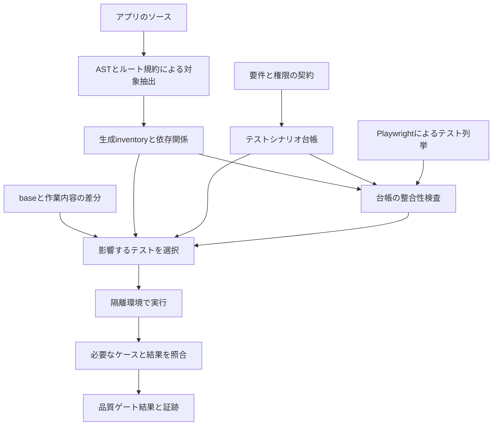

# scenario-manager の E2E 台帳と品質ゲートの導入調査

調査日: 2026-11-04。対象: HEAD `b4c824e` と調査時の作業ツリー。未コミット・未追跡の実装も含む。以下は導入設計であり、記載した新コマンドや台帳はまだ実装していない。

**結論は、既存の Playwright Test を維持し、実装対象の自動抽出・テスト台帳・変更影響の選択・実行結果の照合を追加すること。** その前提として、共有 Supabase と共通ユーザーに依存するテストを、再現可能な専用環境へ移す。Storybook、Vitest、DB権限テストも役割を分けて使う。

参照記事の核は、ソースから確認対象を拾い、テストとの対応を管理し、更新漏れを検出することにある。関連する E2E をローカルの開発フローで実行する運用も紹介している。本プロジェクトでは、その考え方を Next.js・Supabase・Cloudflare の構成へ適合させる。[元記事](https://zenn.dev/polyco/articles/26624b38c951b5)

本調査はコード・設定・公式資料の確認に基づく。DBへの接続、既存E2Eの実行、CI履歴の確認はしていない。したがって、現在の成功率・実行時間・現行クラウドDBの実設定は未測定である。

**1. 現在の資産と導入の位置付け**

| 対象 | 確認した状態 | 導入時の扱い |
|---|---|---|
| Next.js / React | 16.1.6 / 19.2.3 | App Router に合わせて抽出する |
| Playwright | lockfile 上で Test / playwright ともに 1.57.0 | 既存 runner を継続 |
| アプリE2E | 25 spec、通常 `test(...)` 定義178箇所 | IDを付け、実際のassertionを読んで台帳へ対応付ける |
| E2Eの無効化 | `test.skip(...)` 18箇所、`test.fixme(...)` 定義1箇所 | 必須ケース・対象外・外部接続用に整理 |
| Page Object | 14ファイル | locatorと操作を再利用 |
| Storybook | 135 storyファイル、追跡済み117 | UI状態検証の基盤として活用 |
| Storybookブラウザテスト | 4 spec、通常test定義24箇所 | UIの表示・操作・モック失敗状態を検証 |
| Vitest | `src/**/*.test.ts(x)` 113ファイル | 純粋unit / component / DB integrationを分離 |
| ページ | `page.tsx` 31、うちparallel slot配下8、interception3 | URLと表示経路を区別 |
| レイアウト | `layout.tsx` 5 | 共通影響範囲として扱う |
| Route Handler | 8ファイル・8メソッド、GET 7 / POST 1 | `/auth/callback` も対象 |
| Server Action候補 | ファイル先頭に`use server`がある13ファイル、export関数37 | 読取・更新・wrapperを区別 |
| 楽観的更新 | 本番ソース11ファイルで`useOptimistic`使用 | 成功・失敗・再読込を別観点にする |

テスト定義数は TypeScript AST による静的集計で、ループ・project展開後の実行件数ではない。Server Action数も「37の更新機能」を意味しない。検索やwrapperを含む。

Storybookブラウザテストのうち、`pages.spec.ts`・`recruitment-detail.spec.ts`・`session-panels.spec.ts` は調査時点で未追跡。これらがmainに導入済みとは扱わない。以後の基準作成では、取り込む変更を確定したコミットから再集計する。

既存設定は [package.json](C:/Development/Nextjs/scenario-manager/package.json)、[Playwright設定](C:/Development/Nextjs/scenario-manager/playwright.config.ts)、[Vitest設定](C:/Development/Nextjs/scenario-manager/vitest.config.ts)、[Storybook設定](C:/Development/Nextjs/scenario-manager/.storybook/playwright.config.ts) にある。

**2. 最初に解消する問題**

| 優先度 | 確認した問題 | 導入への影響と対応 |
|---|---|---|
| 先行 | CIがcheckout前にローカルcomposite actionを参照 | 各job先頭でcheckoutし、その後setupを呼ぶ |
| 先行 | Vitestのunitに実Supabaseを使うテストが混在 | DB不要の検査と、専用DBが必要な検査を分離 |
| 先行 | 全認証E2Eが同じstorageStateを使用 | worker・実行単位でアカウントと変更対象データを分離 |
| 先行 | `seed.sql`指定はあるがファイルがない | migrationsとfixtureだけから初期化できるようにする |
| 先行 | 主要テーブルのRLSがmigrationから再現できる保証がない | 必要なschema / policy / grantを確認し、ローカル再現性を確立 |
| 高 | cleanupがservice-role未設定で何もせず終了 | 専用環境で作成IDを記録し、後始末失敗を検出 |
| 高 | DBエラー時にassertion前でreturnするテスト | 「何も確認せずpassed」をなくす |
| 高 | serial suiteの途中だけ選ぶと前提が欠ける | 実行group全体を選ぶか、各caseを独立fixture化 |
| 高 | `dispatchEvent('click')`で操作障害を回避 | 通常clickで操作可能性を検証 |
| 高 | 開発時の画像アップロードはダミー成功 | R2用実行環境の検証を別途設ける |

CIの順序は [.github/workflows/test.yml:12](C:/Development/Nextjs/scenario-manager/.github/workflows/test.yml:12) と [.github/actions/setup/action.yml:7](C:/Development/Nextjs/scenario-manager/.github/actions/setup/action.yml:7) で確認できる。空のhosted runnerでは、まだ取得していないlocal actionの内部checkoutへ到達できない。[GitHub公式の構成例](https://docs.github.com/en/actions/tutorials/create-actions/create-a-composite-action#creating-a-composite-action-within-the-same-repository)

[testClient.ts](C:/Development/Nextjs/scenario-manager/src/__tests__/helpers/testClient.ts) は実Supabase clientを作る。[feedbackのadapterテスト:23](<C:/Development/Nextjs/scenario-manager/src/app/(main)/feedback/__tests__/adapter.test.ts:23>) には、DBエラーを受けて早期returnする補助関数がある。ランナー上のpassedだけでも、assertionが実行された保証にはならない。

[cleanup.ts:64](C:/Development/Nextjs/scenario-manager/e2e/helpers/cleanup.ts:64) はservice-role keyがなければreturnし、CIのE2E stepはそのkeyを渡していない。削除APIのerrorも確認していない。共有環境へservice-roleを追加するだけでは解消せず、隔離先と削除対象を限定する必要がある。

過去の [E2E基盤計画](C:/Development/Nextjs/scenario-manager/docs/plans/e2e-testing-plan.md) は本番DB接続と記載し、現行の [testing-patterns.md](C:/Development/Nextjs/scenario-manager/.claude/rules/testing-patterns.md) は共有cloud Supabaseと記載している。現在のSecrets接続先は未確認であり、本番と断定しない。

**3. 全体構成**



「対象が登録されている」「対応するテストが存在する」「そのテストが必要な環境で成功した」「assertionが要件を十分に確認する」の4つを分ける。最後の意味の確認はレビューで補い、静的解析による完全自動保証とはしない。

ここでいうテストシナリオはTRPGのシナリオと別概念である。台帳はリポジトリ内のJSONとして管理し、業務DBの`scenarios`テーブルには追加しない。テスト管理専用のWeb画面も初期導入には不要。

**4. Next.js向けの抽出器**

TypeScript Compiler APIを使う。既存のTypeScript依存を利用し、正規表現だけでAST相当の解析を再実装しない。`tsconfig.json`のaliasを解決し、import / re-export / wrapperを追う。

| 対象kind | 抽出内容 | 意味を補う契約 |
|---|---|---|
| route | `src/app/**/page.tsx`、動的segment、route group、slot、interception | 公開範囲、期待する表示・遷移 |
| action | ファイル・関数の`use server`、exportされた関数 | 読取/更新、許可actor、フェーズ、保存対象 |
| api | `route.ts`のGET/POST等 | 認証、入力、応答、保存の要件 |
| surface | 機能UIの操作入口、form、callback、リンク | ユーザー操作の意味、対応するcase |
| dependency | UI→Action→adapter→table/RPC、共通hook・schema | 解決できない動的依存の明示登録 |
| external | 外部fetch、OAuth、R2等の境界 | stub/live、許可宛先、期待される副作用 |
| database | migrationsとRPC依存 | RLS/GRANT/関数権限のテスト対象 |

`src/app/api`だけを走査すると`/auth/callback`を落とす。`actions.ts`という名前だけを探すと共通部品やinline Actionを落とす。初版から関数内directiveを検出し、未対応なら明示エラーにする。

routeの正規化では、`(main)`等のgroupと`@detail`をURLから除き、`[id]`を維持する。ただし表示経路は保持する。たとえば`/scenarios/[id]`を、standaloneと一覧からのintercepted表示に分けて管理する。ソースpathと表示variantを組にして衝突を防ぐ。

通常のリンク遷移とURL直アクセス・reloadではinterceptionの挙動が異なる。したがって同じURLのテスト1件では両方の検証にならない。[Next.jsのIntercepting Routes](https://nextjs.org/docs/app/api-reference/file-conventions/intercepting-routes)、[Parallel Routes](https://nextjs.org/docs/app/api-reference/file-conventions/parallel-routes)

UI抽出には`onClick`だけでなく、`onSubmit`、form action、RHFの`handleSubmit`、Ark UIの`onValueChange`等、propsで渡すAction、`.bind(null, id)`、Link、router操作を含める。匿名ハンドラの行番号を恒久IDにすると整形で大量変更になるため、関数・コンポーネント単位のキーと操作一覧のfingerprintを使う。

基本部品のButton内部クリックを全画面のE2E対象へ重複展開しない。部品内部はcomponent契約、呼出側の業務操作は機能surfaceとして扱う。handler件数は変化通知に使えても、各操作がassertされた証明には使わない。

意味を静的に判断しにくい箇所は、抽出対象に紐付く`contracts/*.json`で許可actor・保存・必須観点を宣言する。新しいActionに契約がない場合もエラーにする。解析できない依存や宛先を黙って無視せず、診断と対象箇所を出す。登録の追加・例外化には理由を必須にする。

SQLのpolicy一覧をmigrationの`CREATE POLICY`検索だけで作らない。DROP・rename・関数置換を経た最終状態を表せないためである。初版ではmigration変更をDBテスト全件へ広げ、専用DBのmigration適用後catalogからpolicy/RPCの現存状態を検査する仕組みを後続で足す。

**5. テスト台帳のデータ構造**

Zodで構造を検証し、型はスキーマから導出する。生成inventory、要件契約、テスト台帳、実行結果を別ファイルにする。生成物へ手で説明を足さない。

台帳の1件は、実装の関数1件と同義ではなく、利用者から見た結果を表す。たとえば「GMが日程を確定し、参加者が再表示して確認できる」を1つの業務フローとし、入力・権限・競合等は別caseへ分ける。

以下は新規設計の形を示す例で、既存テストの充足を宣言するものではない。

```json
{
  "id": "SCH-001",
  "title": "管理者が日程を確定すると再表示後も参加者へ反映される",
  "status": "planned",
  "checks": [
    {
      "target": "action:src/app/(main)/sessions/[id]/schedule/confirm/actions.ts#confirmScheduleTimeBlocksAction",
      "aspect": "persist",
      "requiredLayer": "browser-e2e",
      "caseIds": ["SCH-001-PERSIST"]
    }
  ],
  "cases": [
    {
      "id": "SCH-001-PERSIST",
      "actors": ["operator", "confirmed-player"],
      "variants": ["operator-is-creator-only", "operator-is-keeper-only"],
      "projects": ["chromium-auth", "mobile-chrome-auth"],
      "runtime": "next-node",
      "fixtures": ["session-preparation"],
      "executionGroup": "schedule-confirmation"
    }
  ]
}
```

`checks`は対象と観点を1組ずつ結ぶ。トップレベルの`aspects: [normal, persist]`と大量の`covers`だけで管理すると、1つの保存確認で無関係な対象まで永続化確認済みと見なす危険がある。

`cases`は必要な組合せを明示する。actorの一覧は「どれか1人を実行すればよい」という意味にしない。複数actorが参加する1つのcaseなのか、別variantなのかを区別する。全権限×全画面×全端末の無条件直積は作らない。

例の`operator`はvariantに応じてcreatorのみ、keeperのみのユーザーへ結び付ける。両方を兼ねる場合と、どちらでもない拒否ケースは別caseとして用意する。

IDは`AUTH`・`USR`・`SCN`・`SES`・`REC`・`SCH`・`FDB`・`UPL`等の領域prefixで発行し、削除後に再利用しない。Playwright内部の`TestCase.id`はファイル・タイトル・project等に依存するため、台帳の恒久IDに使わない。

テストにはscenarioとcaseのタグを付ける。case variantのタグ、fixtureから報告するactor情報、project名を組み合わせて照合する。actorをタグに書くだけで実際の権限になったとは扱わず、fixtureがログインしたユーザーと関係性を検証する。

```ts
test('確定日程が再表示後も参加者に見える', {
  tag: ['@SCH-001', '@SCH-001-PERSIST', '@operator-is-keeper-only'],
}, async ({ page }) => {
  // 専用fixtureを使い、UIで操作し、再取得した結果を確認する
})
```

台帳にtestのファイル位置を重複手入力するより、タグから現在位置を発見する。`playwright test --list`とcustom reporterで実際の登録を列挙すれば、describeやデータ駆動テストにも追従できる。列挙でもconfig/test moduleのimportは走るので、トップレベルのDB操作は禁止する。[Playwright CLI](https://playwright.dev/docs/test-cli)、[Reporter API](https://playwright.dev/docs/api/class-reporter)

**6. どの層で何を確認するか**

| 検査層 | 主な責務 | その層だけで保証しないこと |
|---|---|---|
| Vitest unit | schema、状態遷移、日付計算、検索条件、parser | ブラウザ操作、実DB認可 |
| component / Storybook | 入力・エラー・loading・空状態・レスポンシブ・キーボード・rollback表示 | サーバー保存、RLS |
| DB integration / pgTAP | RLS、GRANT、RPC認証、原子性、制約、競合 | 実UIからの到達可能性 |
| browser E2E | UI→Action/API→DB→再読込、主要権限、URL状態 | 実Discord等の外部サービス全体 |
| Cloudflare runtime | OpenNext/workerd、R2 binding、画像保存・取得 | 本番環境の設定そのもの |
| live integration | 実OAuth、外部サイト取込、必要な環境接続 | すべての業務組合せ |

要件ごとに許容する証拠の層を決める。たとえば保存を保証するcheckにStorybookのmock成功を紐付けても不合格。UI操作が要件なら、DB/API直接呼出だけでも代替しない。

各runnerの結果を共通の証拠形式へ変換するadapterも必要になる。Playwrightはタグとreporter、Vitestは安定IDを含むtest登録とreporter、pgTAPはSQLテストに割り当てたIDとTAP結果を対応付ける。共通形式はcase ID・検査層・実行条件・各caseの結果・run fingerprintを持ち、単に`pnpm test:db`全体が成功しただけで個別checkを充足扱いにしない。

段階BではPlaywrightの証拠登録までを実装する。Vitest/DBは独立した品質ゲートとして実行し、個別IDと結果adapterが整った層から台帳の充足へ組み込む。未対応の層を参照するcheckは未検証として残し、Playwrightの結果で代用しない。pgTAPの個別case内に複数assertionがある場合も、全assertionの成功と欠落のないことを条件にする。

認可は、ボタン非表示、Action/APIでの拒否、DBでの拒否を分ける。Next.jsのServer Actionsも認証・認可を持つ公開入口として扱う必要があり、レイアウトで非表示にするだけでは十分でない。[Next.js 16.1.6 Data Security](https://github.com/vercel/next.js/blob/v16.1.6/docs/01-app/02-guides/data-security.mdx)

DBテストは通常の利用者JWTまたはSQLのrole/JWT切替で行う。service-roleで成功した結果をRLS確認済みとは扱わない。Supabase公式もpgTAPとアプリclient経由の検査を区別している。[Supabase Testing](https://supabase.com/docs/guides/local-development/testing/overview)、[RLS](https://supabase.com/docs/guides/database/postgres/row-level-security)

**7. このプロジェクトで必須にする観点**

| 領域 | 必須にする確認 |
|---|---|
| 認証 | 匿名、Authのみ登録済み、アプリ会員、失敗、logout、returnTo、desktop popup / mobile redirect |
| 一覧・詳細 | 絞込、sort、pagination、空・error、URL直アクセス、一覧から詳細、reload、戻る/進む、詳細を閉じても条件維持 |
| シナリオ | 作成・編集・favorite、入力拒否、保存後の再取得、重複URL、取込の成否 |
| セッション | creator≠keeper、申請/承認/取消/辞退、定員、二重操作、禁止遷移、競合 |
| 日程 | 提出権限、フェーズ制限、複数time block、一括replace失敗時の原子性、日付またぎ、JST境界 |
| 非公開情報 | GMメモ・キャラシURLが権限外へ渡らない。DOMに加えJSON/RSC等の応答も確認 |
| フィードバック | 投稿、投票、取消、永続化、MODERATORだけのstatus変更 |
| 画像 | 形式・サイズ・認証要件、保存失敗、保存後取得、R2 runtimeとの接続 |
| 楽観的更新 | 即時表示、拒否時rollback、再読込での確定、競合後の表示 |

グローバルroleは`MEMBER` / `MODERATOR`だが、セッション権限はそれだけで表現できない。managerはkeeperまたはcreator。承認済player、spectator、申請中、辞退済、無関係な会員、匿名、アプリ未登録をfixtureで作れるようにする。

managerのOR条件は、creatorのみのactor、keeperのみのactor、どちらでもないactorを独立に確認する。creatorとkeeperが別人のセッションを作るだけでは、両方の許可分岐を検証したことにならない。

特に [viewModel.ts](<C:/Development/Nextjs/scenario-manager/src/app/(main)/sessions/[id]/viewModel.ts>)、[participantAdapter.ts](<C:/Development/Nextjs/scenario-manager/src/app/(main)/sessions/participantAdapter.ts>)、[日程確定Action](<C:/Development/Nextjs/scenario-manager/src/app/(main)/sessions/[id]/schedule/confirm/actions.ts>)、[RPC認証migration](C:/Development/Nextjs/scenario-manager/supabase/migrations/0022_fix_schedule_rpc_auth_and_type.sql) を契約作成の対象にする。

期待値を現在の実装から自動転記しない。要件・既存設計・合意した権限表を根拠にし、実装と違えば仕様か実装かを判定する。たとえば [uploadのPOST](C:/Development/Nextjs/scenario-manager/src/app/api/upload/route.ts:19) に認証確認はないため、匿名uploadを許す仕様か確認対象にする。これを自動的に「正しい匿名成功」として台帳化しない。

**8. 再現可能な実行環境**

初期は1つの専用local stackを占有して運用し、安定後に複数runへ広げる。worktreeを作るだけではDB・ポート・認証ファイルの共有は解消しない。既存checkoutを再利用し、同一checkoutでは1つのbuild/E2Eだけが動くロックを置く。別worktreeで同時実行する場合は環境も別にする。

1. 実行IDを発行し、必要なポート・build出力・レポート先・DB projectを予約する。
2. 本番や共有環境を指していないことを、URL許可リストと実行環境manifestで検証する。
3. 専用SupabaseのPostgres・Auth・PostgRESTを起動し、migrationを適用する。
4. fixture用Authユーザーとアプリuserを作成し、業務データをseedする。
5. build前にアプリとテストへ同じ接続設定を渡す。`NEXT_PUBLIC_*`はbuildに埋め込まれる点を考慮する。
6. worker/actor用storageStateを作り、実際のログイン状態と権限を確認する。
7. Next production buildで必要なテストを実行する。
8. 結果を検査し、所有するプロセス・データ・一時環境だけを片付ける。

Auth UUIDとアプリULIDは別物なので、`users.auth_user_id`まで正しく結び付ける。アカウントは`run × project × worker`を基本にし、プロフィール等はcase前に再初期化する。セッション・投票対象等の変更される行もcase所有にする。ユーザーだけ分けても同じ対象行を更新すれば競合する。[Playwrightのworker別認証](https://playwright.dev/docs/auth#moderate-one-account-per-parallel-worker)

[rateLimit.ts:35](C:/Development/Nextjs/scenario-manager/src/lib/rateLimit.ts:35) はプロセス内Mapへ`userId:action`ごとの履歴を保存する。DBだけ戻してもこの履歴は残るため、作成・取込等のcaseはcase別actorを使うか、テスト専用のserver状態を隔離する。ブラウザの時計だけを固定してもserverの`Date.now()`は変わらない。制限自体の境界テストではserverの時計も制御できる設計を用意し、MODERATORの制限免除で通常caseを回避しない。

service-roleはこの専用環境の準備と後始末だけに使う。作成したIDをmanifestに記録し、そのIDだけを削除する。prefix一致による共有データの一括削除へ依存しない。途中中断でも後始末を試み、残留と失敗を報告する。

port 3100だけでなく、Supabase API/DB/Studio等、Storybook、fixture server、Cloudflare previewも衝突対象になる。固定portを無差別にkillする現在の`pretest:e2e`は、並列化時に所有PID方式へ置き換える。既存devの3000固定は維持し、テスト環境の予約とは分ける。

Supabase CLIのproject識別とport設定を実行単位に生成し、CLI・container imageを固定する。現在の公式資料にはCLI v3等の新しい案内もあるため、実装時に採用するCLIの`--version` / `--help`でコマンドを確認する。本資料は未検証の起動flagを確定しない。[Supabase local development](https://supabase.com/docs/guides/local-development/overview)

DB環境の先行受入条件は、空DBからの復元、全fixture生成、同じcaseの連続実行、2 workerの同時実行、権限外アクセス拒否、後始末後の残留検出である。現状の失敗をすべてseed不足と推定するのではなく、更新・認可テストを拡張するための再現性要件として導入する。

**9. 外部I/OとCloudflareの扱い**

画像保存はSupabase StorageではなくR2である。[upload/route.ts:64](C:/Development/Nextjs/scenario-manager/src/app/api/upload/route.ts:64) がCloudflare contextを取得し、`SCENARIO_IMAGES.put()`を呼ぶ。開発モードではplaceholder URLを返すので、その成功をR2検証済みと数えない。

通常のNode E2Eでは明示的な画像保存adapterを差し替え、画像関連のruntime契約はOpenNext/Cloudflare previewのlocal R2 bindingで検証する。Node production serverでCloudflare contextが利用できるとは仮定しない。実R2へ接続する検査が必要なら、専用bucketとprefixを持つ別profileにする。[OpenNext bindings](https://opennext.js.org/cloudflare/bindings)、[R2 Workers API](https://developers.cloudflare.com/r2/api/workers/workers-api-usage/)

local bindingへの保存と、返却した公開URLからの取得を結ぶ必要もある。現行APIは`R2_PUBLIC_URL`または公開R2 URLを返すため、bindingをlocal化しただけでは画像GETが保存先へ届かない。local objectを配信する読出adapter/routeとURL設定を用意し、返却URLから保存したbytesを取得できるところまで確認する。

BOOTH/TALTOの取込はserver fetchである。ブラウザの`page.route()`だけでは差し替えられない。外部clientのtransport差替えかfixture HTTP serverを用意し、成功・timeout・404・壊れたHTMLを再現する。URL validation / redirect検証等のセキュリティ処理をstubのために迂回しない。

通常E2Eはlocal Authで業務機能を検証する。Discord popup / redirect / callbackのアプリ側挙動は専用caseを持ち、実Discordとの接続は別profileで検証する。ローカル認証を使っても、callback検証が済んだことにはしない。

ブラウザとサーバーの両方で、意図しない外向き通信を拒否・記録する。URLをDBへ保存するだけの操作と、実際の外部送信は別対象。実環境へ送るprofileは既定実行から分離するが、契約が必要とする実行時に未設定なら「成功」にせず未検証として扱う。

**10. 変更から実行対象を選ぶ仕組み**

初版は機能ディレクトリ単位の選択と共通変更時の全件実行で始める。AST依存グラフによる細粒度化は、誤って必要テストを省かないことを確認してから入れる。

選択処理は次を行う。

1. CIではPR base/headを固定しmerge-baseを取得する。ローカルではそれにstaged / unstaged / untrackedを加える。
2. Gitの追加・変更・削除・renameをNUL区切りで読み、Windows pathを正規化する。
3. base側とhead側の対象・依存グラフの両方から影響先を探す。削除された依存をheadだけで見落とさない。
4. 対象→台帳check→case→project / variant / runtimeへ展開する。
5. setup依存と`executionGroup`を含める。serial lifecycleは途中だけを抜き出さない。
6. 各選択の理由と、対象外にした理由をJSONへ保存する。

| 変更 | 初期の実行方針 |
|---|---|
| 特定機能のpage/action/adapter/schema | その機能のE2E・component・integration |
| 共通認証・認可・Supabase client・root layout | 広い回帰または全E2E |
| migrations / RPC | DB integration全件＋関連書込E2E。関係不明なら全E2E |
| Button / Select等の共通操作部品 | 全consumerの関連E2E＋関連Storybook。consumerを確定できなければ全E2E |
| 色等の純粋なvisual tokens | 関連Storybook・画像比較。操作領域/レイアウトにも影響する変更はE2Eを広げる |
| Next/OpenNext/config/lockfile/テスト基盤 | 全件または明示した広域profile |
| テストだけの変更 | 変更テストと同じ実行groupを必ず実行 |
| 台帳・契約・例外・selectorの変更 | 整合検査＋影響するcase。ゲート緩和をレビュー |
| 純粋な文書のみ | 対象なしの理由を出して終了 |
| 解決不能な依存・不明な変更分類 | 全件へ拡大するか明示エラー。0件成功にしない |

`vitest --changed`やrunnerのAI filterだけにアプリE2Eの選択を任せない。ブラウザテストは対象画面をimportせずURLで訪問することがあり、コードのimport依存だけでは関係を表せない。

採用前は、選択器の結果と全件回帰を同じ変更で比較する運用を設ける。過去変更や意図的な回帰で「本来必要なcaseが選ばれるか」を検査する。実行時間削減率より、必要ケースの取りこぼしがないことを先に確認する。

**11. 合否判定と証跡**

静的検査では、inventoryの再生成一致、対象/契約/checkの参照、必須観点、実test登録、case/variant/projectの整合、例外理由、baseline差分を確認する。削除済対象への参照、ID重複、未知のID、消えたテスト、`.only`等も検出する。

実行後は、選択時に確定した必要集合と実結果を照合する。単なるexit code 0や`outcome() === 'expected'`では不十分である。後者には失敗を期待する`test.fail()`も含まれる。

- 必須のcase・variant・actor binding・project・runtimeから展開した登録testとrepeatがすべて存在する。
- 対応する全登録testの期待statusと最終statusがpassedである。一部のtestやrepeatだけの成功で充足させない。
- runner全体のfailed / interrupted / timedout、および予期しない失敗を合格にしない。
- skipped / fixme / interrupted / missing / expected-failureを成功へ算入しない。
- retryで成功したflakyは分けて報告し、重要ゲートでは失敗にする。
- setupやcleanupの失敗、レポート欠損、必須0件は失敗にする。
- 正式に対象外とした端末などは、実行前に必要集合から除き、理由を持たせる。

これらの情報はPlaywright 1.57.0のreporter/CLIで取得できる。`--fail-on-flaky-tests`、`--list`、`--test-list`、tags等が同版に存在する。[v1.57.0 CLI実装](https://github.com/microsoft/playwright/blob/v1.57.0/packages/playwright/src/program.ts)、[reporter型](https://github.com/microsoft/playwright/blob/v1.57.0/packages/playwright/types/testReporter.d.ts)

reporterはデータ出力を担い、独立した結果checkerが最終exit codeを決める。reporter内の例外が必ず品質ゲート失敗になるという仮定を置かない。

証跡にはbase/head、作業内容fingerprint、lockfile、fixture/migration、inventory/台帳/selectorのversion、環境profile、選択理由、期待件数、実結果、traceへのpathを記録する。実行開始と終了でソースfingerprintが違えば、その証跡を現在変更の合格として再利用しない。test module・設定・stub・seedもfingerprintへ含める。

通常の実行出力は`.artifacts/e2e/<runId>/`等へ置きgitignoreする。認証cookie・token・環境変数の値をレポートへ保存しない。traceも認証済データを含み得るため、専用fixtureと保存期限で扱う。

ローカル証跡は再現とレビューの補助であり、改ざん不能な認証ではない。CIはソースから選択と検査を再実行する。署名機構だけを足してCIの再検証を省く設計にはしない。

**12. 既存不足の段階的な管理**

不足を件数だけで保存せず、対象・観点・検査層と、必要な実行の組（case・variant・actor binding・project・runtime）を正規化して保持する。1件解消して別の不足1件を追加しても同数だから許可、という扱いを防ぐ。同じcaseにdesktopの不足があるからといって、新しいmobileの不足を既存baselineへ吸収しない。

初期導入時の不足はbaselineとして記録する。通常変更では新たな不足を増やさず、解消した項目は削除する。比較元はPR側が書き換えたbaselineではなく、信頼できるbase revisionのものを読む。baseを取得できない場合は自動承認せずエラーにする。

例外には対象、理由、追跡先、責任者、必要なら見直し期限を持たせる。根拠のない「該当なし」や、必須観点を削ってゲートを通す変更をレビュー対象にする。renameで継承する不足は旧→新の対応を明示し、無関係な別機能への転用を認めない。

一方で、新しい端末を全体へ追加するような検証方針の拡張は、通常機能PRと別の移行変更として扱えるようにする。方針拡張による新しい義務と、既存義務の取りこぼしを区別してレビューする。

**13. コマンドとファイル構成の提案**

以下は提案名であり、現時点では実行できない。

```text
scripts/e2e/
  inventory.mts          Next/TS抽出の入口
  extractors/            routes、actions、surfaces、dependencies
  ledger.mts             schema/coverage/baseline照合
  discover-reporter.ts   test登録の出力
  select.mts             差分から実行集合を計算
  environment.mts        専用環境の準備・所有・後始末
  result-reporter.ts     case/project/variantの実結果を出力
  evidence-adapters/     後続でVitest/TAPを共通の証拠形式へ変換
  verify-results.mts     必要集合と実結果の照合
  run.mts                実行全体の入口
e2e/ledger/
  schema.ts
  inventory.generated.json
  contracts/
  scenarios/
  exceptions.json
  pending-baseline.json
e2e/fixtures/
  actors.ts
  sessions.ts
  feedbacks.ts
  external/
supabase/tests/
  RLS・RPC・制約の検査
```

初期段階で全部を別モジュールにしない。たとえば小さい抽出器は1ファイルから始め、契約が固まってから分割する。runnerと台帳の責務は最初から分ける。

| 新コマンド案 | 責務 |
|---|---|
| `pnpm e2e:inventory` | inventory更新。書込みあり |
| `pnpm e2e:ledger:check` | 再抽出・登録・baseline照合。書込みなし |
| `pnpm e2e:select --base <sha>` | 実行集合と選択理由を出力 |
| `pnpm e2e:verify --base <sha>` | 専用環境→選択実行→結果照合→後始末 |
| `pnpm e2e:verify:all` | 全件回帰 |
| `pnpm test:db` | 専用DBで認可・RPC検査 |
| `pnpm test:runtime` | Cloudflare runtimeの検査 |
| `pnpm quality:changed --base <sha>` | lint・型・unit・台帳・必要なUI/DB/E2Eの完了ゲート |

現在の`pnpm check`は`biome check --write`なので、CIの読み取り専用品質ゲートと同義にしない。自動整形コマンドは維持し、CIでは非書込みのBiome検査を呼ぶ。途中でソースが自動修正されたなら、実行集合とfingerprintを再計算する。

**14. CIとAI開発フローへの組込み**

| タイミング | 検査 |
|---|---|
| 編集中 | 関連unit/component、必要ならdev E2E |
| pre-commit | lint・型・AGENTS同期・軽量な台帳整合。全E2Eは置かない |
| 実装完了 / PR前 | `quality:changed`、失敗調査、意味のレビュー |
| PR CI | 台帳・baseline・型・unit、関連Storybook、選択E2E＋認証/更新/認可の必須smoke |
| DB変更PR | 上記にDB integration全件を追加 |
| 大規模変更 / release前 / 定期 | 全E2E、必要なCloudflare runtime検証 |
| live profile | 専用環境で外部接続を検証。通常ゲートの結果と分ける |

最初から既存のCI E2Eを削減しない。専用環境と選択器の安定性を実測してから負荷を減らす。PRに貼られたローカル結果だけで、CIの重要経路検査を置き換えない。

AIの実装手順には「対象差分を確認→要件を確認→テスト/台帳を更新→選択理由を確認→実行→結果とassertionをレビュー」を入れる。テストを通す目的のskip追加、期待値の実装追従、例外拡大、baseline付替えはレビューで確認する。

規約は `.claude/rules/testing-patterns.md` を中心に更新する。このファイルは既に `scripts/gen-agents-md.mjs` のwhitelistにある。`AGENTS.md`を直接編集せず`pnpm gen:agents`で再生成する。

`.claude/skills/exec-plan/SKILL.md`等の実装完了条件にも共通コマンドを接続する。Codex用skillは正本とexport手順を合わせる。Claude専用の`.claude/rules/codex-harness.md`へ接続する場合も同じコマンドを使い、別の判定ロジックを作らない。

**15. 導入順序と完了条件**

| 段階 | 作業 | 完了条件 |
|---|---|---|
| A 現状固定 | 取り込む変更を確定、CI順序修正、unit/DB分離、既存結果分類 | DB不要検査が独立し、失敗/skip/早期returnが識別できる |
| B 最小台帳 | route/action/api抽出、実test列挙、タグ、契約・baseline | 新規Action/削除test/古い参照を意図的に入れると検査が失敗 |
| C 再現環境 | schema/policy再現、seed、actor fixture、cleanup、外部stub | 空DBから復元し、2 workerで独立実行できる |
| D 代表フロー | 日程確定・参加・投票・詳細遷移の実テスト | 永続化、拒否、rollback、PC/mobileの必要caseが実行される |
| E 完了ゲート | 機能単位の選択、結果照合、fingerprint、AIフロー接続 | missing/skip/flaky/stale reportをゲートが検出 |
| F 全体へ拡張 | 機能別不足を解消、surface/依存解析を拡張、R2/runtime | baseline減少を確認し、全件比較で選択漏れを検査 |

最初の試行対象は、`confirmScheduleTimeBlocksAction`を中心にした日程確定が適する。UI・manager権限・フェーズ・RPC・保存・再表示を横断するため、基盤の弱点を早期に確認できる。ただし最初のDB疎通はさらに小さな読取/保存caseで行い、複雑な日程UIの問題と環境問題を切り分ける。

gate自体には故障を意図的に与えるテストを用意する。新しいrouteを未登録で追加、testを削除、ID重複、必須mobileをskip、expected-failure、serial groupの不足、source変更後の古いreport、unknown依存、結果ファイル欠損などで正しく失敗することを確認する。通常の実装をそのまま写すだけのテストより、検査の抜け道を潰すテストを優先する。

作業量は、最小台帳と既存CI補正が比較的小さく、DB再現・fixture・既存テストの独立化が大きい。所要日数はDBの管理外設定と現状E2E結果に左右されるため、段階A/Cの実測前に全体を固定見積りしない。台帳だけを短期間で導入できても、全機能の検証が完了したとは扱わない。

**16. 紹介ライブラリを採用するか**

| 観点 | Playwright Testを継続 | tester-army/e2e |
|---|---|---|
| 既存test/POM | そのまま活用できる | 独自API/runnerへの適合が必要 |
| 台帳・選択・結果照合 | 自作する | 同様に自作が必要 |
| AIによる操作・探索 | 別途追加して評価 | agent操作・探索・replay cacheを提供 |
| Windows | 現在のnative環境を維持 | 公式quickstartはWSLでの実行を案内 |
| Node | 現行基盤と合わせて検証 | 公式要件は24.8+、または22系22.22.3+ |
| 安定性 | 既存運用と資産がある | 1.0前でminorでもAPI/config変更の可能性を明記 |

上記e2eの条件は調査日に読んだ公式mainの仕様であり、採用時は固定versionで再確認する。[公式repository](https://github.com/tester-army/e2e)、[quickstart](https://github.com/tester-army/e2e/blob/main/docs/quickstart.mdx)

AI操作のcacheは、すべてのassertionやモデル呼出を不要にするものではない。探索のfindingも仕様確認と再現を経て回帰テストへ変換する必要がある。導入するなら、正式な合否は決定的なassertionと外部結果checkerで維持し、限定した探索用途から比較する。[cache](https://github.com/tester-army/e2e/blob/main/docs/cache.mdx)、[explore](https://github.com/tester-army/e2e/blob/main/docs/explore.mdx)

移行判断は、同じ対象に対する初回作成時間・UI変更時の修正時間・flaky率・誤合格・モデル費用・WSL運用負担を比較して行う。本プロジェクトの台帳導入に、runner移行を前提条件とする理由はない。

**17. 運用で測る指標**

- 契約がある対象の割合と、未解決の抽出診断数。
- `target × aspect × required-case`に対する実装済み率と実行済み率。
- 必須テストのskip / missing / flaky / expected-failure件数。
- baselineの追加・解消・期限超過。
- 環境準備・build・テスト・後始末それぞれの時間。
- 選択実行と全件実行の差、選択漏れによる不具合。
- fixture競合、残留データ、意図しない外部通信。
- 実行成功後にレビューで発見したassertion不足。

「テストが何本あるか」だけを達成指標にしない。要件を変更したときに対象が拾われ、適切なcaseが選ばれ、必要な環境で成功し、その結果を説明できることを導入完了の基準にする。
